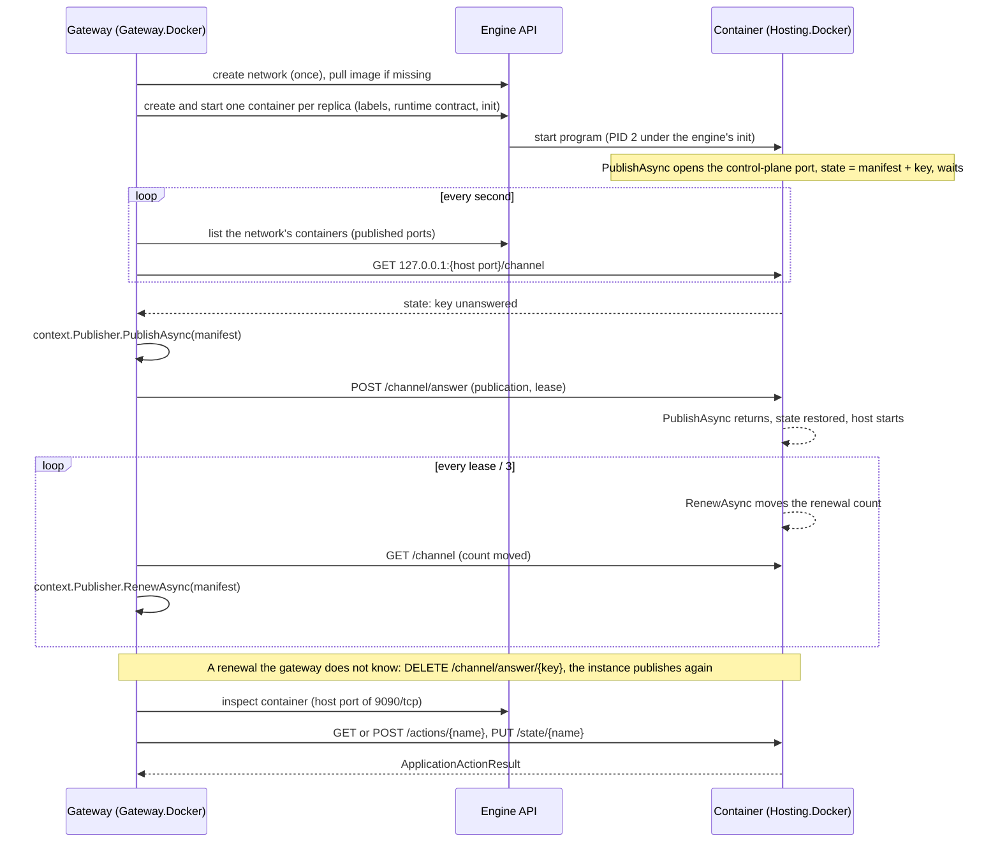

# Assimalign.Cohesion.ApplicationModel.Gateway.Docker — Design

The gateway half of the Docker platform pair, rebuilt on 2026-10-31 for the application-model
restart (assimalign/cohesion#1759, contracts decision C5 "platform pairs"), after the Kubernetes pair
and on its pattern. It replaces the plan-compiler implementation (`cohesion/plan/v1`, the Containers
dependency, Gateway.ControlPlane), which is in this repository's history before this change. The BCL
Engine API client survived, trimmed to the calls the platform makes.

## Role

`DockerInfrastructure` is both of the gateway's platform seams:

| Seam | What it does on Docker |
| --- | --- |
| `IApplicationGatewayInfrastructureProvider` | Plans, deploys, watches, reports the outputs of, and tears down each resource as containers on the gateway's network. Its `StartAsync(context)` and `StopAsync` run the inbound channel (GD2): it polls the network's instance containers and hands their publications and renewals to `context.Publisher`. |
| `IApplicationGatewayInstanceClient` | Calls an instance's control plane on the loopback port the engine published it on. |

`builder.UseDocker(infrastructure)` sets it as both. The instance half,
`Assimalign.Cohesion.ApplicationModel.Hosting.Docker`, is the other end of the channel and the
client. The two halves never reference each other: the protocol they share, variables, endpoint
forms, channel routes and documents, is one file, `Hosting.Docker/shared/DockerProtocol.cs`,
compiled into both.

## The exchange

## Decisions

**GD1 — The gateway pulls, over the container's published control-plane port (2026-10-31).** There
is no address both sides reach the way Kubernetes' API server is (GK1), and a container cannot count
on reaching a gateway on the engine's host: `host.docker.internal` exists on Docker Desktop only,
Podman names it `host.containers.internal` and only for some network modes, and Linux Docker needs an
explicit host-gateway mapping. What every engine does is publish a container port on its host. So
every connection goes gateway → container: the engine publishes each container's control-plane port
(9090 by default) on an ephemeral loopback port of its host, the gateway finds that port in the
engine's listing, and reads and answers the instance's channel there.

- *Verified* on a rootful Podman 5.8.6 WSL machine on Windows ARM64, whose WSL localhost forwarding
  carries a `127.0.0.1::9090` binding to the Windows host, and by the end-to-end tests.
- *Rejected:* the instance pushing to a listener of the gateway. It needs a host address reachable
  from containers on every engine, and a host firewall rule for it.
- *Rejected:* `docker exec` into the container to read its state. It needs a process per poll, and an
  exec API Podman's compatibility layer implements only in part.
- *Rejected:* host networking. It exists on Linux engines only, and gives up the network's names.

**GD2 — The instance keeps its side of the channel, and the gateway answers there (2026-10-31).** The
instance's state (`DockerChannelState`: manifest, instance key, the keys the gateway answered or
refused, and a renewal count) is the Lease of the Kubernetes pair (GK2), held in the instance's
memory and served on its port. The channel lists the network's containers every second and reads each
running one's state, all at once:

- a state whose answered key is not its instance key is a publication: the channel calls
  `context.Publisher.PublishAsync` and posts the publication, or the refusal's reason, to
  `POST /channel/answer`, which names the key it answers;
- a state whose answer is current and whose renewal count moved is a renewal: the channel calls
  `RenewAsync`, and for an instance the gateway does not know it clears the answer
  (`DELETE /channel/answer/{key}`), so the instance's next renewal reports itself unknown and it
  publishes again;
- a container that does not answer, such as one whose program has not opened its port yet, is read
  again on the next poll. A gateway that restarts reads every instance once, so an instance an
  earlier run answered is a renewal (GD8).

The renewal is a count rather than a time because only the gateway compares it, and only for change.

**GD3 — Calls go over the same port.** A read is `GET actions/{name}`, a write `POST actions/{name}`, a
restore `PUT state/{name}`, at `http://127.0.0.1:{host port}/`. The control-plane endpoint an instance
publishes, `docker:///networks/{network}/containers/{container}:{port}/`, names the container and the
port inside it; the client inspects the container on every call for the host port the engine
published that port on, because Docker can publish it elsewhere after the container restarts. The
client refuses any other form. A control plane answers every outcome with a result (200, 400, 404, or
405); any other status, such as the 503 of an instance whose control plane is not open yet, or a body
that is not a result, is no answer and throws `HttpRequestException`.

**GD4 — One network per gateway, and what runs there.** Deploying a resource creates:

- the network (`DockerInfrastructureOptions.Network`, default `cohesion`), a bridge labelled
  `com.assimalign.cohesion.managed-by=cohesion`, once;
- one container per replica of the resource's image, joined to the network with the resource's name
  as its alias, labelled with the network, the provider, the resource, the deployment, the revision,
  the workload (GD5), and its replica number, and receiving the runtime contract as its environment
  exactly as Kubernetes hands it (GK4): `COHESION_APPLICATION`, `COHESION_GATEWAY=docker`,
  `COHESION_RESOURCE`, `COHESION_MANIFEST_ENDPOINT=docker:///networks/{network}`,
  `COHESION_DEPLOYMENT`, the `http` endpoint on `0.0.0.0:EndpointPort`, `COHESION_ENVIRONMENT` when
  the gateway has one, every setting as a `COHESION_CONFIG__` variable, plus the container's own name
  (`DOCKER_CONTAINER_NAME`) and control-plane port (`DOCKER_CONTROL_PLANE_PORT`);
- both of the container's ports published on ephemeral ports of `127.0.0.1`: the control-plane port
  for the channel (GD1), and the `http` port for a developer on the host, and the end-to-end test.

The resource's `endpoint` output is `http://{name}:{EndpointPort}`: its alias on the network, where
every container of the resource answers, so a dependent's setting reaches it by the engine's DNS.

**GD5 — A workload decides an update; the revision is what the model does not carry (2026-10-31).**
The provider contract (`PlanResourceAsync`) says the revision fingerprints what the provider deploys
that the model does not carry and leaves out the settings' values and the extensions, because the
gateway treats a new revision as a new definition, which starts without the state recorded for the
previous one. So two hashes, each the first 16 hex digits of a SHA-256:

- the **revision**: the platform's template version (`DockerWorkload.TemplateVersion`, 1), the image,
  and both ports. `PlanResourceAsync` returns it.
- the **workload**: the revision, the replica count, and the settings in ordinal order. It is a
  label on every container, and it decides the plan: no container of the resource is a create, as
  many containers as replicas all running the workload is nothing, and anything else is an update.

Kubernetes puts both into one revision (Gateway.Kubernetes open question 5). Containers are named
`{network}-{resource}-{workload[..8]}-{replica}`, so an update's containers never collide with the
ones they replace: it creates and starts its own, then removes the others. A container of the same
name from an attempt that did not finish is kept when it is the same deployment's and replaced
otherwise.

**GD6 — The program is never PID 1.** Every container runs under the engine's init
(`HostConfig.Init`: `docker-init` on Docker, `catatonit` on Podman), so the program is PID 2. A .NET
program that is PID 1 cannot end itself with a default-action signal: one whose start fails with an
unhandled exception calls `abort()`, which PID 1 ignores, and on arm64 glibc then spins. Observed with
the fixture image under Podman 5.8.6 linux/arm64 on 2026-10-31: without an init the container stayed
`Up` with the program at 78 % CPU; under the init the same image exited with 134 at once. The same
finding made Kubernetes share each pod's process namespace (GK6).

**GD7 — The engine restarts a container, and the watch reports one that keeps ending.** Containers run
with the restart policy `unless-stopped`, as a Deployment restarts its pods. Watching a deployment
lists its containers every second and fails the step at once when one has `exited` or is `dead`, has
restarted twice (a restart loop), or was `created` with an engine error such as a missing executable.
The failure names the container and the engine's reason, then the last 20 lines the program wrote,
so an unhandled exception reaches the gateway's error. While the engine restarts a container, it
reports the exit code of the current run, not the last, so the reason gives the code only when it is
not 0. The watch ends when the deployment's containers are gone: a later deployment replaced them or a
teardown removed them.

**GD8 — Workloads outlive the gateway.** A gateway that stops leaves its containers running; one that
runs again over the same network adopts them: its plan reads the same workload and changes nothing,
and the instances, which it does not know, renew, are sent to publish again (GD2), and register.
Tearing a resource down removes its containers; the network stays, as the Kubernetes namespace does.

**GD9 — The engine is resolved as the docker CLI resolves it**, and spoken to directly. The options'
`Endpoint`, then `DOCKER_HOST`, then the platform's default: `npipe:////./pipe/docker_engine` on
Windows, which a Podman machine serves too, and `unix:///var/run/docker.sock` elsewhere (Podman's is
`unix:///run/podman/podman.sock`, rootful). `tcp://` is plain HTTP; TLS and SSH are refused (open
question 2). `DockerEngineClient` is the BCL's `HttpClient` over a Unix socket, a named pipe, or TCP,
with source-generated JSON, so the package takes no Docker SDK; it negotiates the highest API version
both sides speak, from 1.41 (Podman's compatibility API) to 1.51.

**GD10 — `replicas` is the platform's one extension so far, under its own verb.** A JSON number of at
least 1 on the `docker` platform, written by `WithDockerReplicas(int)`; without it a resource runs one
container. The verb is not `WithReplicas`, Kubernetes' name for its own: a gateway program that may run
on either platform declares both counts (the gateway hands each provider only its platform's
extensions, ApplicationModel.Gateway G25), and two `WithReplicas` members would be ambiguous there.

**GD11 — An image per resource, pulled by policy.** `AddImage(provider, name, image)` binds a resource
to the image that runs it, as on Kubernetes. `ImagePullPolicy` is `IfNotPresent` (pull when the engine
has none by that reference), `Always`, or `Never`. The image must be built for the engine's
architecture: a Podman machine on an arm64 host is linux/arm64.

## Open questions

1. **The channel and the control plane have no authentication** (Hosting.Docker HD5). Publishing on
   loopback keeps the ports off other machines, but any process on the engine's host, and any
   container on the network (port 9090 directly), can read an instance's state, answer its
   publication, or call its actions. A per-container secret the gateway sets in the container's
   environment and sends with every request would close both.
2. **Remote engines.** Ports are published on the engine's loopback, so a gateway reaches them only on
   the engine's host. A `tcp://` engine elsewhere, and TLS (`DOCKER_TLS_VERIFY`) or SSH endpoints,
   need a reachable publish address and those transports.
3. **Rollout.** An update removes the previous containers once its own have started, not once they
   published; dependents can miss the resource for a moment. Waiting for the new instances' first
   publication needs the provider to hear from the channel.
4. **Readiness and liveness.** Containers have no health check. Kubernetes probes the `http` port
   (GK10); Docker could do the same with a `HEALTHCHECK`, which the fixture image cannot run without a
   probe binary, or the gateway could probe the published port.
5. **Polling.** Every second the channel lists the network's containers and reads each one's state.
   Cheap for a developer's machine; an events stream (`/events`) could replace the listing.
6. **Image architecture**, as Kubernetes open question 3.

## Diagnostics

The package raises no events yet: it has no `EventSource`.
