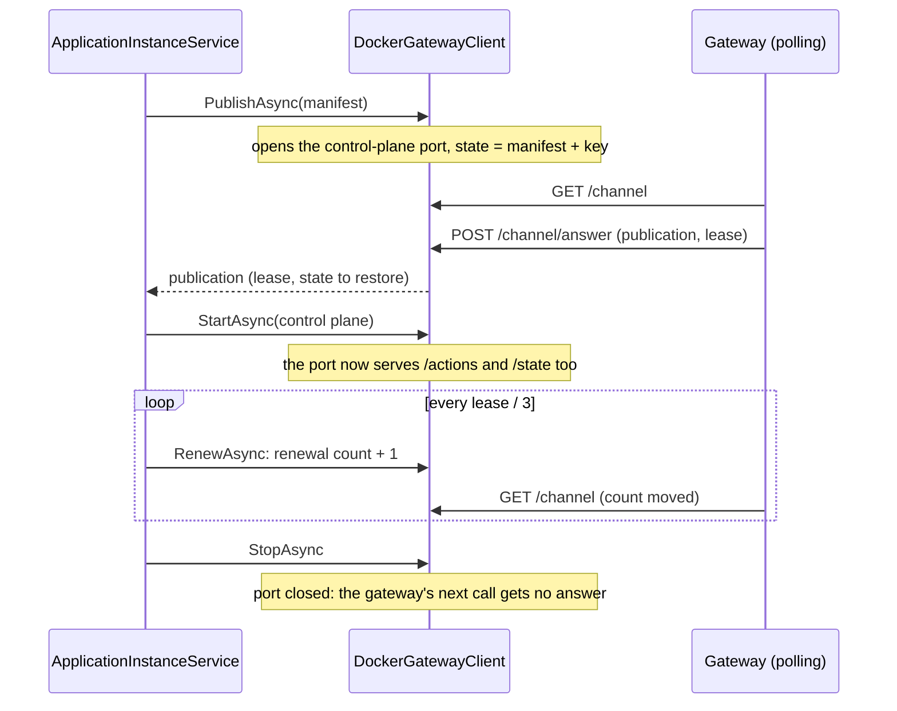

# Assimalign.Cohesion.ApplicationModel.Hosting.Docker — Design

The instance half of the Docker platform pair (assimalign/cohesion#1759, contracts decision C5
"platform pairs"; the gateway half is `Gateway.Docker`, whose DESIGN.md has the whole exchange). The
package is one internal `IApplicationInstanceGatewayClient`, `DockerGatewayClient`, and the
extension that adds it.

## Lifecycle

`ApplicationInstanceService` drives the client as it drives every platform's: it publishes and
restores in `StartingAsync`, before any of the program's services or servers start, opens the
gateway's calls in `StartAsync`, and closes them in `StopAsync`, after the program's servers have
drained.

## Decisions

**HD1 — The container is the instance's identity.** The client reads its container's name from
`DOCKER_CONTAINER_NAME`, its control-plane port from `DOCKER_CONTROL_PLANE_PORT` (default 9090), and
its gateway's network from the manifest endpoint, `docker:///networks/{network}`. The gateway half
sets all of them on every container. An environment without the endpoint or the container's name
fails the publication before the client opens its port.

**HD2 — Publishing opens the port and waits for the gateway's answer there.** The gateway pulls
(Gateway.Docker GD1), so the client cannot send its manifest: it stamps the manifest's control-plane
endpoint, `docker:///networks/{network}/containers/{container}:{port}/`, sets the channel's state to
that manifest and the instance's key with no answer, opens the control-plane port if it is not open,
and waits for the gateway's `POST /channel/answer` for that key, for up to 60 seconds. A refusal or no
answer fails the publication, and with it the program's start. An answer for another key, from a
gateway that read an earlier state, is refused with 409. Publishing again, as the service does after
a renewal the gateway did not know, clears the earlier answer, so the gateway answers again.

**HD3 — Renewing moves the renewal count.** While the state carries the gateway's answer for the
instance's key, a renewal adds one to its count, which the gateway sees on its next poll, and returns
`true`. A state without that answer, because the gateway cleared it (`DELETE /channel/answer/{key}`),
returns `false`, and the service publishes again. A gateway that is gone leaves the answer in place, as
a Lease keeps its annotations, so the instance keeps serving and renewing until a gateway reads it.

**HD4 — One listener, two sets of routes.** The port is an `HttpListener` on every interface of the
container (on Windows, `localhost`, which needs no URL reservation): the shared
`platforms/Shared/InstanceControlPlaneListener.cs`, linked source the Kubernetes instance half
compiles too (Hosting.Kubernetes HK4). It serves the channel's routes from the publication on
(`GET /channel`, `POST /channel/answer`, `DELETE /channel/answer/{key}`), and the control plane's
(`GET /manifest`, `GET` and `POST /actions/{name}`, `PUT /state/{name}`) once `StartAsync` hands it
the control plane; before that they answer 503, which the gateway takes for no answer, as the
contract wants for a call that arrives before the restored state is in effect. `StopAsync` closes the
port and forgets the state.

**HD5 — No authentication yet.** The port is published on the engine host's loopback only, but a
process on that host, or a container on the network, can reach it (Gateway.Docker open question 1).

## Diagnostics

The package raises no events yet: it has no `EventSource`.
