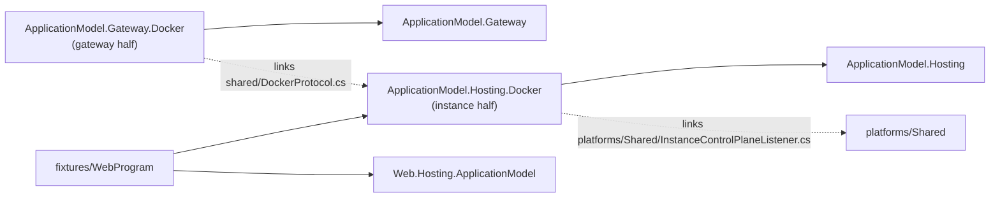

# Docker (platform area)

The Docker platform of Cohesion's application model, as a pair of halves (assimalign/cohesion#1759,
contracts decision C5 "platform pairs"), on the Kubernetes pair's pattern: a gateway half that runs a
gateway's resources as containers on a Docker-compatible engine, Podman's included, and an instance
half each resource's program opts into. The gateway runs on the engine's host and pulls: it reaches
each instance on the loopback port the engine publishes the container's control-plane port on, so a
container needs no address of its gateway.

## Projects

| Project | Half | Purpose |
| --- | --- | --- |
| `Assimalign.Cohesion.ApplicationModel.Gateway.Docker` | Gateway | `DockerInfrastructure`, the gateway's infrastructure provider (which is also its inbound channel) and instance client in one: each resource is one container per replica on the gateway's network under the resource's name, the gateway polls each container's published control-plane port for its instance's publication and renewals, and calls its control plane there. Talks to the engine's API directly, with no Docker SDK. `builder.UseDocker(infrastructure)`, `resource.WithDockerReplicas(count)`. |
| `Assimalign.Cohesion.ApplicationModel.Hosting.Docker` | Instance | The gateway client a resource's program adds on its `ApplicationInstanceOptions`: `builder.Services.AddResource(name, options => options.UseDocker())`. Its `shared/DockerProtocol.cs` is the protocol both halves compile. |
| `fixtures/WebProgram` | Test input | The end-to-end tests' resource program: an ordinary Web application that opts its resource into the platform. Built as a container image, never packed. |



Arrows are references; the dotted ones are linked source, not references. How the halves talk, and
the decisions behind it, are in the gateway half's
[DESIGN.md](Assimalign.Cohesion.ApplicationModel.Gateway.Docker/docs/DESIGN.md).

## Building

As for Kubernetes: CI builds both halves against the cohesion CI build that `CohesionPackageVersion`
pins in `build/Targets/Build.References.Packages.targets`, and `ci-packages.yml` publishes them to
GitHub Packages at a CI version of their own. Locally, build against the sibling cohesion checkout's
packages:

```powershell
pwsh -NoProfile -File .github/scripts/Pack-CohesionSibling.ps1 -Local
dotnet test platforms/Docker/Assimalign.Cohesion.ApplicationModel.Hosting.Docker/tests/Assimalign.Cohesion.ApplicationModel.Hosting.Docker.Tests.csproj -p:CohesionSiblingPackageVersion=10.0.0-preview.1.local
dotnet test platforms/Docker/Assimalign.Cohesion.ApplicationModel.Gateway.Docker/tests/Assimalign.Cohesion.ApplicationModel.Gateway.Docker.Tests.csproj -p:CohesionSiblingPackageVersion=10.0.0-preview.1.local
```

The gateway half's unit tests run the instance half in process: a fake engine lists a container
whose control-plane port is published where the instance's client listens, so the channel and the
instance client are tested over HTTP without an engine.

## The end-to-end tests on an engine

`DockerEndToEndTests` runs a gateway in the test process against a real engine:

- two instances of `orders-api` and a `storefront` whose setting is `orders-api`'s endpoint, a
  request to the storefront on its published port, which it answers through `orders-api` on the
  network, and a write through the gateway that every `orders-api` instance then answers;
- a second gateway over the same network, without the first one's record, that adopts the container
  the first left running;
- a program that fails its start, which fails the gateway's start at once with the container's exit
  and the program's last output.

They are skipped unless `COHESION_DOCKER_E2E=1`. The engine is `COHESION_DOCKER_ENDPOINT`, else
`DOCKER_HOST`, else the platform's default: on Windows the `docker_engine` pipe, which a Podman
machine serves. Then:

```powershell
pwsh platforms/Docker/scripts/Publish-CohesionDockerFixtures.ps1
$env:COHESION_DOCKER_E2E = '1'
dotnet test platforms/Docker/Assimalign.Cohesion.ApplicationModel.Gateway.Docker/tests/Assimalign.Cohesion.ApplicationModel.Gateway.Docker.Tests.csproj -p:CohesionSiblingPackageVersion=10.0.0-preview.1.local --filter "FullyQualifiedName~DockerEndToEndTests"
```

`Publish-CohesionDockerFixtures.ps1` builds the fixture image for the engine's architecture (a Podman
machine on an arm64 host is linux/arm64) and loads it into the engine's store as
`cohesion-docker-web:e2e` (`-Engine Podman` or `-Engine Docker`; the first on PATH by default). Each
test runs on a network of its own and removes its containers and the network when it ends; set
`COHESION_DOCKER_KEEP_NETWORK=1` to keep them to inspect.

First passed on 2026-10-31 on Windows ARM64 against a rootful Podman 5.8.6 WSL machine: three tests
in 11 seconds, the first run included. `.github/workflows/e2e-docker.yml` runs them on GitHub's x64
runners' Docker engine, on demand and weekly, and fails unless every test executed and passed.
