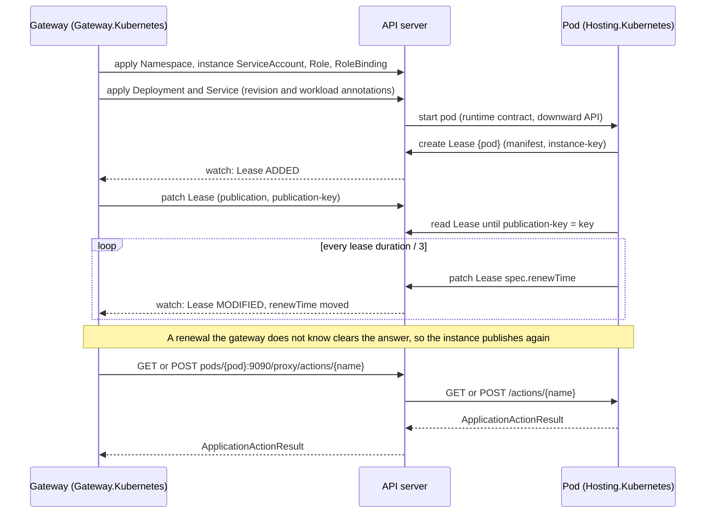

# Assimalign.Cohesion.ApplicationModel.Gateway.Kubernetes — Design

The gateway half of the Kubernetes platform pair, rebuilt on 2026-10-30 for the application-model
restart (assimalign/cohesion#1759, contracts decision C5 "platform pairs"). It replaces the
plan-compiler implementation, which is in this repository's history at `f779b85`; what still has to
come back from it is listed under [Backfill](#backfill).

## Role

`KubernetesInfrastructure` is both of the gateway's platform seams:

| Seam | What it does on Kubernetes |
| --- | --- |
| `IApplicationGatewayInfrastructureProvider` | Plans, deploys, watches, reports the outputs of, and tears down each resource as a Deployment and a Service. Its `StartAsync(context)` and `StopAsync` run the inbound channel (GK11): it watches the namespace's instance Leases and answers their publications and renewals through `context.Publisher`. |
| `IApplicationGatewayInstanceClient` | Calls an instance's control plane through the API server's pod proxy. |

`builder.UseKubernetes(infrastructure)` sets it as both. The instance half,
`Assimalign.Cohesion.ApplicationModel.Hosting.Kubernetes`, is the other end of the channel and the
client. The two halves never reference each other: the protocol they share, names and endpoint
forms, is one file, `Hosting.Kubernetes/shared/KubernetesProtocol.cs`, compiled into both.

## The exchange

## Decisions

**GK1 — Everything goes through the API server.** A pod cannot count on reaching a gateway outside
the cluster (on kind over Podman, `host.containers.internal` does not resolve from a pod), and a
gateway outside the cluster cannot reach a pod's address. The API server is the one address both
sides reach, with the cluster's own authentication and authorization. No port is published and no
ingress is needed for the platform to work.

**GK2 — Publication and renewal ride one Lease per pod.** The instance creates a
`coordination.k8s.io/v1` Lease named after its pod, labelled
`app.kubernetes.io/managed-by=cohesion` and `cohesion.assimalign.com/role=instance`, owned by the
pod so the cluster deletes it with the pod. Its annotations carry the manifest and the instance key.
The channel lists, then watches, the instance Leases of its namespace and answers a publication
whose key it has not answered by calling the gateway and writing `publication` and
`publication-key`, or `refusal` and `refusal-key`, back with the gateway's lease as
`leaseDurationSeconds`. A renewal is a moved `spec.renewTime`. A renewal the gateway does not know,
because it restarted or the lease lapsed, clears the answer, and the instance publishes again.

**GK3 — Calls go through the pod proxy.** A read is `GET actions/{name}`, a write
`POST actions/{name}`, a restore `PUT state/{name}`, under
`api/v1/namespaces/{namespace}/pods/{pod}:{port}/proxy/`. The control-plane endpoint an instance
publishes, `kubernetes:///namespaces/{namespace}/pods/{pod}:{port}/`, names exactly that; the client
refuses any other form. A control plane answers every outcome with a result body (200, 400, 404, or
405); any other status, or a body that is not a result, such as the API server's own status for a
pod that is gone, is no answer and throws `HttpRequestException`.

**GK4 — One namespace per gateway, and what runs there.** Deploying a resource applies, with
server-side apply under the field manager `cohesion-gateway`:

- the namespace (`KubernetesInfrastructureOptions.Namespace`, default `cohesion`);
- the instance access, `cohesion-instance`: a ServiceAccount, a Role that may manage Leases and
  nothing else, and their RoleBinding;
- a Deployment named after the resource, whose pods run its image under that account and receive
  the runtime contract as their environment (`COHESION_APPLICATION`, `COHESION_GATEWAY=kubernetes`,
  `COHESION_RESOURCE`, `COHESION_MANIFEST_ENDPOINT=kubernetes:///namespaces/{namespace}`,
  `COHESION_DEPLOYMENT`, the `http` endpoint on `0.0.0.0:EndpointPort`, every setting as a
  `COHESION_CONFIG__` variable) plus their own pod through the downward API and the control-plane
  port;
- a Service on port 80 in front of the `http` endpoint.

The resource's `endpoint` output is the Service's cluster name,
`http://{name}.{namespace}.svc.cluster.local`, so a dependent's setting reaches it through cluster
DNS.

**GK5 — A workload decides an update; the revision is what the model does not carry
(2026-10-31, superseding the one-hash revision of 2026-10-30).** The provider contract
(`IApplicationGatewayInfrastructureProvider.PlanResourceAsync`) says the revision fingerprints what the
provider deploys that the model does not carry, and leaves out the settings' values and the
extensions: the gateway fingerprints the manifest as declared for this platform, extensions included,
itself, and treats a new revision as a new definition, which starts without the state recorded for
the previous one (ApplicationModel.Gateway G12). So two hashes, each the first 16 hex digits of a
SHA-256, as Docker's (Gateway.Docker GD5):

- the **revision**: the platform's template version (`KubernetesWorkload.TemplateVersion`, GK10), the
  image, and both ports. `PlanResourceAsync` returns it, and it is the
  `cohesion.assimalign.com/revision` annotation on the Deployment and its pod template.
- the **workload**: the revision, the replica count (GK7), the image pull policy, the environment
  name the pods receive (`COHESION_ENVIRONMENT`, copied from the gateway's own), and the settings'
  values in ordinal order, each value prefixed with its length as the gateway's deployment id is, so
  no two sets of values hash alike whatever they contain (a PEM or JSON value included). The pull
  policy and the environment name reach the pods but define nothing, so they are here and not in the
  revision: changing them rolls the pods and keeps the recorded state. The workload is the
  `cohesion.assimalign.com/workload` annotation on the Deployment only, and it decides the plan with
  the Deployment's rollout status: no Deployment is a create; one that carries the workload and has
  rolled it out (`observedGeneration` ≥ `generation`, and `updatedReplicas`, `availableReplicas` and
  `replicas` all equal to the spec's replicas, as `kubectl rollout status` decides) is nothing; any
  other is an update. A Deployment an earlier template version created carries no workload, so it is
  updated. A rollout that has not finished, or failed (a new pod in `CrashLoopBackOff`), is an update
  too, of the same deployment id: the apply changes nothing, and the watch reports why the rollout
  does not finish, instead of the plan marking the resource ready with nothing watched.

A dependency's redeploy that moves a filled-in setting therefore updates this resource and keeps its
recorded action state. A new image, port, or template version starts it over, as a change to the
resource's declaration does, its `replicas` extension included, because the gateway fingerprints that
itself.

A deployment's pods decide its watch. Each pod carries its deployment's id as a label.
Watching a deployment polls its pods every two seconds and fails the step at once with the platform's
reason when one is waiting on `CrashLoopBackOff`, `ImagePullBackOff`, `InvalidImageName`,
`CreateContainerConfigError`, or `CreateContainerError`. The watch ends when the Deployment is gone or
a later deployment replaced it.

*Superseded:* one revision over the template version, image, ports, replica count, and settings. It
told the gateway that a moved setting was a new definition, so a dependency's redeploy discarded the
resource's recorded action state (open question 5 until it closed on 2026-10-31). Moving to the split changed every running
Deployment's revision once (template version 3), so the first gateway run after it clears every
resource's recorded action state once. Accepted before the first release: no deployment outside test clusters carries
recorded state yet.

**GK6 — The program is never PID 1.** Pods share their process namespace, so the pause container is
PID 1. A program that is PID 1 cannot end itself with a default-action signal: a .NET program whose
start fails with an unhandled exception calls `abort()`, which PID 1 ignores, and on arm64 glibc
then spins forever. The pod stays `Running` and the watch never sees the failure. Observed with the
fixture image under Podman on 2026-10-30; under an init process the same image exits with 134.

**GK7 — `replicas` is the platform's one extension so far.** A JSON number of at least 1 on the
`kubernetes` platform, written by `WithReplicas(int)`; without it a Deployment runs one pod. The
gateway hands a resource's extensions only to a provider of their platform.

**GK8 — Workloads outlive the gateway.** A gateway that stops leaves its Deployments and Services
running; one that runs again over the same namespace adopts them, and their instances publish to it
again (GK2). Tearing a resource down deletes its Deployment and Service; the namespace and the
instance access stay.

**GK9 — The cluster is resolved as kubectl resolves it:** the options' kubeconfig path, the first
file `KUBECONFIG` names that exists, the default kubeconfig, then the pod's service account.

**GK10 — A pod is ready once its program accepts connections (2026-10-31).** The container has a TCP
readiness probe on its `http` port, every 2 seconds, unready after 3 misses. The program opens its
server only after its instance has published and restored the gateway's state (Hosting D19). So the
Service routes to a pod only from then on, and a rollout replaces a pod only once its successor is
ready.

- **TCP, not HTTP.** The platform does not know the program's routes, and the status an HTTP GET
  returns would say nothing about readiness.
- **The gateway's step does not wait for it.** The step completes when an instance publishes
  (ApplicationModel.Gateway). A dependent deployed right after can find the Service without an
  endpoint for a moment, and retries.
- **The probe is part of the workload template.** Every revision carries the template's version
  (`KubernetesWorkload.TemplateVersion`: 2 since the probe, 3 since the revision split of GK5), so a
  gateway updates the Deployments an earlier version created.
- *Rejected:* a readiness route on the control plane. It would also cover a resource with no `http`
  endpoint, but the instance would have to tell its platform's client when its host has started,
  which needs a new member on the ApplicationModel.Hosting contract (open question 1).
- *Rejected:* a liveness probe on the endpoint. It would also restart a pod whose program is still
  waiting for its gateway's answer.

**GK11 — The Lease watch is the provider's channel (2026-10-31).** ApplicationModel.Gateway folded
its transport seam into the infrastructure provider (ApplicationModel.Gateway G39 and G40, superseding G33), so the
watch is no longer a seam of its own. The gateway calls the provider's `StartAsync(context)` once
per run, after it loads its record and before it plans; the provider ensures the namespace exists
and starts the internal `KubernetesLeaseChannel` over `context.Publisher`. `StopAsync` stops the
watch; the gateway calls it when the run ends. `DisposeAsync` stops it too, for a provider disposed
without a run ending. The Lease protocol (GK2) is unchanged.

- *Rejected:* keeping a separate channel object for the builder to register. The builder no longer
  takes one (`UseTransport` is gone), and the channel shares the infrastructure's client and
  namespace.

## Open questions

1. **Readiness without an `http` endpoint, and liveness.** The readiness probe (GK10) assumes the
   program listens on its `http` endpoint, as every Web resource does. A worker would never become
   ready, which stalls its rollouts. A readiness route on the control plane, set once the host has
   started, would cover every kind of resource; liveness would use the same route.
2. **The control plane has no authentication of its own** (Hosting.Kubernetes HK4). Calls through
   the pod proxy are the API server's to authorize, but another pod can reach a pod's control-plane
   port directly. A NetworkPolicy or a credential the gateway holds is needed before the platform
   leaves a test cluster.
3. **Image architecture.** A kind node's architecture is its host's, so an x64 image does not run on
   an arm64 machine. `scripts/Publish-CohesionKindFixtures.ps1` builds for the Podman machine's
   architecture; a multi-architecture image would remove the choice.
4. **CI.** `platform-kubernetes.yml` builds and tests both halves on every push.
   `e2e-kubernetes.yml` runs `KubernetesEndToEndTests` on kind over the x64 runner's Docker engine
   (both scripts' `-Engine docker`), on demand and weekly, and fails unless the test executed and
   passed (rewritten 2026-10-31; it drove the original implementation's render conformance and Kind
   smoke test before). It has not run on GitHub yet: once a dispatched run passes, it can gate pushes
   to `platforms/Kubernetes`. Locally it passes on kind over Podman (first on 2026-10-30: kind
   0.33.0, Kubernetes 1.37.0, arm64).

## Diagnostics

The package raises no events yet: it has no `EventSource`.

## Backfill

The original implementation (`f779b85`, `src/` of this project) still holds Kubernetes behavior this
design has not brought back. In its own words, by the files that carried it:

- other workload kinds: StatefulSet, DaemonSet, and Job, with headless governing Services and claim
  templates (`KubernetesPlanCompiler`, `KubernetesPlanController`);
- volumes and claims, retained across removals (`KubernetesPlanController`);
- liveness and startup probes, and workload readiness reported to the gateway (`KubernetesReadinessRule`;
  the readiness probe itself is GK10);
- ConfigMap and Secret runtime inputs with a rollout revision (`KubernetesPlanCompiler`);
- autoscaling (`KubernetesHpaOptions`, `KubernetesHpaSurface`) and disruption budgets
  (`KubernetesPodDisruptionBudgetOptions`, `KubernetesPodDisruptionBudgetSurface`);
- the system installation and its exposure, Ingress or LoadBalancer (`KubernetesSystemInstallation`,
  `KubernetesSystemExposure`);
- deployment records in the cluster (`KubernetesResourceRecordStore`), now the gateway's
  `IApplicationGatewayStore`, which the owner wants backed by the Database resource;
- image publication and the Kind registry route (`KubernetesImageGatherer`,
  `KubernetesImageRegistryRoute`, `KubernetesKindCluster`).

What the original implementation had for concepts the restart retired, such as its trusted-issuer
keys (`KubernetesGatewayTrustKeyRepository`), does not come back.
