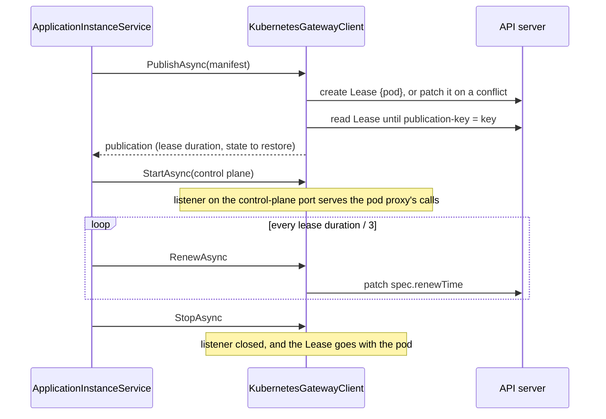

# Assimalign.Cohesion.ApplicationModel.Hosting.Kubernetes — Design

The instance half of the Kubernetes platform pair (assimalign/cohesion#1759, contracts decision C5
"platform pairs"; the gateway half is `Gateway.Kubernetes`, whose DESIGN.md has the whole exchange).
The package is one internal `IApplicationInstanceGatewayClient`, `KubernetesGatewayClient`, and the
extension that adds it.

## Lifecycle

`ApplicationInstanceService` drives the client as it drives every platform's: it publishes and
restores in `StartingAsync`, before any of the program's services or servers start, opens the
gateway's calls in `StartAsync`, and closes them in `StopAsync`, after the program's servers have
drained.

## Decisions

**HK1 — The pod is the instance's identity.** The client reads its pod's name, namespace, and UID
from the downward API (`KUBERNETES_POD_NAME`, `KUBERNETES_POD_NAMESPACE`, `KUBERNETES_POD_UID`), its
control-plane port from `KUBERNETES_CONTROL_PLANE_PORT` (default 9090), and its gateway's namespace
from the manifest endpoint, `kubernetes:///namespaces/{namespace}`. The gateway half sets all of
them on every pod. An environment without the endpoint or the pod's name fails the publication
before it reaches the cluster.

**HK2 — Publishing writes the instance's Lease and waits for its answer.** The client stamps the
manifest's control-plane endpoint, `kubernetes:///namespaces/{namespace}/pods/{pod}:{port}/`, then
creates the Lease named after the pod, owned by the pod when its UID is known. A Lease that already
exists, from an earlier run of the same pod, is merge-patched with the new manifest and key and its
earlier answer cleared. The client then reads the Lease every 250 ms until the gateway answers its
key with a publication or a refusal, for up to 60 seconds; a refusal or no answer fails the
publication, and with it the program's start.

**HK3 — Renewing moves `spec.renewTime`.** A Lease that is gone, or that answers another key, means
the gateway no longer knows the instance: renewal returns `false`, and the service publishes again.

**HK4 — The control plane is an `HttpListener` on the control-plane port**, on every interface (on
Windows, `localhost`, which needs no URL reservation). The listener is
`platforms/Shared/InstanceControlPlaneListener.cs`, linked source the Docker instance half compiles
too (2026-10-31), so the two platforms serve a control plane identically without either package
referencing the other. It serves `GET /manifest`,
`GET` and `POST /actions/{name}` (a read and a write: `ApplicationActionOperation.Read` and
`.Write`), and `PUT /state/{name}`, with the control plane's own serializer,
and maps a result to 200 (succeeded), 400 (rejected), 404 (not found), or 405. It has no
authentication of its own: see the gateway half's open question 2.

**HK5 — Outside a pod, the client needs a kubeconfig.** In a pod it uses the pod's service account.
Outside one, as when a developer runs the program against a cluster, it uses the first file
`KUBECONFIG` names that exists, then the default kubeconfig. With neither, the publication fails with
`ClusterUnavailable`, rather than with the client library's last resort, an unauthenticated
`http://localhost:8080`, which is never what an instance means.

## Diagnostics

The package raises no events yet: it has no `EventSource`.
