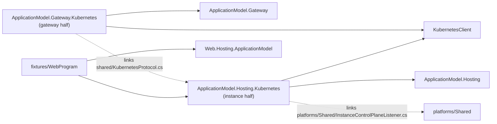

# Kubernetes (platform area)

The Kubernetes platform of Cohesion's application model, as a pair of halves (assimalign/cohesion#1759,
contracts decision C5 "platform pairs"): a gateway half that runs a gateway's resources on a cluster,
and an instance half each resource's program opts into. Both halves reach the cluster only through
its API server, so a gateway runs inside the cluster or outside it alike, and a pod needs no address
of its gateway.

## Projects

| Project | Half | Purpose |
| --- | --- | --- |
| `Assimalign.Cohesion.ApplicationModel.Gateway.Kubernetes` | Gateway | `KubernetesInfrastructure`, the gateway's infrastructure provider (which is also its inbound channel) and instance client in one: each resource is a Deployment and a Service in the gateway's namespace, instances publish and renew through Leases, and the gateway calls their control planes through the pod proxy. `builder.UseKubernetes(infrastructure)`, `resource.WithReplicas(count)`. |
| `Assimalign.Cohesion.ApplicationModel.Hosting.Kubernetes` | Instance | The gateway client a resource's program adds on its `ApplicationInstanceOptions`: `builder.Services.AddResource(name, options => options.UseKubernetes())`. Its `shared/KubernetesProtocol.cs` is the protocol both halves compile. |
| `fixtures/WebProgram` | Test input | The end-to-end test's resource program: an ordinary Web application that opts its resource into the platform. Built as a container image, never packed. |



Arrows are references; the dotted ones are linked source, not a reference. How the halves talk, and
the decisions behind it, are in the gateway half's
[DESIGN.md](Assimalign.Cohesion.ApplicationModel.Gateway.Kubernetes/docs/DESIGN.md).

## Building

CI builds both halves against the cohesion CI build that `CohesionPackageVersion` pins in
`build/Targets/Build.References.Packages.targets`, restored from the GitHub Packages feed.
`ci-packages.yml` then publishes them there at a CI version of their own: `10.0.0-preview.0.pr.<pr>.<run>`
for a pull request, `10.0.0-preview.0.ci.<run>` for `main`. Those packages depend on exactly the
pinned cohesion build, so a consumer pins one build of each repository.

Locally, build against the sibling cohesion checkout's packages instead. Pack them once, and again
after a change there:

```powershell
pwsh -NoProfile -File .github/scripts/Pack-CohesionSibling.ps1 -Local
dotnet test platforms/Kubernetes/Assimalign.Cohesion.ApplicationModel.Hosting.Kubernetes/tests/Assimalign.Cohesion.ApplicationModel.Hosting.Kubernetes.Tests.csproj -p:CohesionSiblingPackageVersion=10.0.0-preview.1.local
dotnet test platforms/Kubernetes/Assimalign.Cohesion.ApplicationModel.Gateway.Kubernetes/tests/Assimalign.Cohesion.ApplicationModel.Gateway.Kubernetes.Tests.csproj -p:CohesionSiblingPackageVersion=10.0.0-preview.1.local
```

A consumer of the packages is planned: `cohesion-examples`' `examples/libraries/ApplicationModel/web-on-kubernetes` will pin a CI version once `ci-packages.yml` has published one.

## The end-to-end test on kind

`KubernetesEndToEndTests` runs a gateway in the test process against a kind cluster: two instances
of `orders-api` and a `storefront` whose setting is `orders-api`'s endpoint, a request to the
storefront through its Service, and a write through the gateway that every `orders-api` instance
then answers. It is skipped unless `COHESION_KIND_CONTEXT` names the cluster's context.

Prerequisites on Windows:

- the kind CLI (`winget install Kubernetes.kind`, or Podman Desktop's Kind extension);
- a rootful Podman machine (`podman machine stop`, `podman machine set --rootful`,
  `podman machine start`), which kind's Podman provider needs.

Then:

```powershell
pwsh platforms/Kubernetes/scripts/New-CohesionKindCluster.ps1
pwsh platforms/Kubernetes/scripts/Publish-CohesionKindFixtures.ps1
$env:COHESION_KIND_CONTEXT = 'kind-cohesion'
dotnet test platforms/Kubernetes/Assimalign.Cohesion.ApplicationModel.Gateway.Kubernetes/tests/Assimalign.Cohesion.ApplicationModel.Gateway.Kubernetes.Tests.csproj -p:CohesionSiblingPackageVersion=10.0.0-preview.1.local --filter "FullyQualifiedName~KubernetesEndToEndTests"
```

`New-CohesionKindCluster.ps1` creates the cluster and a registry at `localhost:5001` that its nodes
pull from. `Publish-CohesionKindFixtures.ps1` pushes the fixture image there, built for the Podman
machine's architecture: a kind node is its host's architecture, so an arm64 machine needs an arm64
image. The test pulls the image on every run, so a republished fixture takes effect at once, and it
deletes its namespace when it ends; set `COHESION_KIND_KEEP_NAMESPACE=1` to keep the namespace of a
run to inspect.

First passed on 2026-10-30 on Windows ARM64: kind 0.33.0, Kubernetes 1.37.0, a rootful Podman 5.8
machine.

Both scripts take `-Engine docker` to run kind on a Docker engine instead. That is how
`.github/workflows/e2e-kubernetes.yml` runs the test on GitHub's x64 runners, on demand and weekly;
it fails unless the test executed and passed, so a skip never reads as a pass.

## Shared with the Docker pair

The instance half's control-plane listener is `platforms/Shared/InstanceControlPlaneListener.cs`,
linked source that `Hosting.Docker` compiles too: each package keeps its own copy, and neither
references the other.
