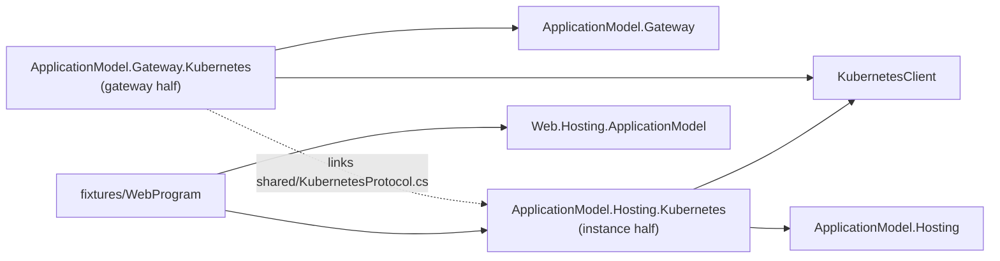

# Kubernetes (platform area)

The Kubernetes platform of Cohesion's application model, as a pair of halves (assimalign/cohesion#1759,
contracts decision C5 "platform pairs"): a gateway half that runs a gateway's resources on a cluster,
and an instance half each resource's program opts into. Both halves reach the cluster only through
its API server, so a gateway runs inside the cluster or outside it alike, and a pod needs no address
of its gateway.

## Projects

| Project | Half | Purpose |
| --- | --- | --- |
| `Assimalign.Cohesion.ApplicationModel.Gateway.Kubernetes` | Gateway | `KubernetesInfrastructure`, the gateway's infrastructure provider, transport, and instance client in one: each resource is a Deployment and a Service in the gateway's namespace, instances publish and renew through Leases, and the gateway calls their control planes through the pod proxy. `builder.UseKubernetes(infrastructure)`, `resource.WithReplicas(count)`. |
| `Assimalign.Cohesion.ApplicationModel.Hosting.Kubernetes` | Instance | The gateway client a resource's program adds with `resource.UseKubernetes()`. Its `shared/KubernetesProtocol.cs` is the protocol both halves compile. |
| `fixtures/WebProgram` | Test input | The end-to-end test's resource program: an ordinary Web application that opts its resource into the platform. Built as a container image, never packed. |



Arrows are references; the dotted one is linked source, not a reference. How the halves talk, and
the decisions behind it, are in the gateway half's
[DESIGN.md](Assimalign.Cohesion.ApplicationModel.Gateway.Kubernetes/docs/DESIGN.md).

## Building

CI builds both halves against the cohesion CI build that `CohesionPackageVersion` pins in
`build/Targets/Build.References.Packages.targets`, restored from the GitHub Packages feed.
`ci-packages.yml` then publishes them there at a CI version of their own: `10.0.0-preview.0.pr.<pr>.<run>`
for a pull request, `10.0.0-preview.0.ci.<run>` for `main`. Those packages depend on exactly the
pinned cohesion build, so a consumer pins one build of each repository.

Locally, build against the sibling cohesion checkout's packages instead. Pack them once, and again
after a change there:

```powershell
pwsh -NoProfile -File .github/scripts/Pack-CohesionSibling.ps1 -Local
dotnet test platforms/Kubernetes/Assimalign.Cohesion.ApplicationModel.Hosting.Kubernetes/tests/Assimalign.Cohesion.ApplicationModel.Hosting.Kubernetes.Tests.csproj -p:CohesionSiblingPackageVersion=10.0.0-preview.1.local
dotnet test platforms/Kubernetes/Assimalign.Cohesion.ApplicationModel.Gateway.Kubernetes/tests/Assimalign.Cohesion.ApplicationModel.Gateway.Kubernetes.Tests.csproj -p:CohesionSiblingPackageVersion=10.0.0-preview.1.local
```

A consumer of the packages is `cohesion-examples`' `examples/libraries/ApplicationModel/web-on-kubernetes`.

## The end-to-end test on kind

`KubernetesEndToEndTests` runs a gateway in the test process against a kind cluster: two instances
of `orders-api` and a `storefront` whose setting is `orders-api`'s endpoint, a request to the
storefront through its Service, and a write through the gateway that every `orders-api` instance
then answers. It is skipped unless `COHESION_KIND_CONTEXT` names the cluster's context.

Prerequisites on Windows:

- the kind CLI (`winget install Kubernetes.kind`, or Podman Desktop's Kind extension);
- a rootful Podman machine (`podman machine stop`, `podman machine set --rootful`,
  `podman machine start`), which kind's Podman provider needs.

Then:

```powershell
pwsh platforms/Kubernetes/scripts/New-CohesionKindCluster.ps1
pwsh platforms/Kubernetes/scripts/Publish-CohesionKindFixtures.ps1
$env:COHESION_KIND_CONTEXT = 'kind-cohesion'
dotnet test platforms/Kubernetes/Assimalign.Cohesion.ApplicationModel.Gateway.Kubernetes/tests/Assimalign.Cohesion.ApplicationModel.Gateway.Kubernetes.Tests.csproj -p:CohesionSiblingPackageVersion=10.0.0-preview.1.local --filter "FullyQualifiedName~KubernetesEndToEndTests"
```

`New-CohesionKindCluster.ps1` creates the cluster and a registry at `localhost:5001` that its nodes
pull from. `Publish-CohesionKindFixtures.ps1` pushes the fixture image there, built for the Podman
machine's architecture: a kind node is its host's architecture, so an arm64 machine needs an arm64
image. The test pulls the image on every run, so a republished fixture takes effect at once, and it
deletes its namespace when it ends; set `COHESION_KIND_KEEP_NAMESPACE=1` to keep the namespace of a
run to inspect.

First passed on 2026-10-30 on Windows ARM64: kind 0.33.0, Kubernetes 1.37.0, a rootful Podman 5.8
machine.

## Original implementation (deleted 2026-10-30)

The sections below describe the plan-compiler implementation the restart replaced, which is in this
repository's history at `f779b85`. They stay as the reference for bringing its behavior back (the
gateway half's DESIGN.md, "Backfill") and are not the current design.

### Design item 34 delivery

- `KubernetesPlanCompiler` accepts every validated `cohesion/plan/v1` plan through one generic
  path. It maps `plan.Workload.Kind` to Deployment, StatefulSet, DaemonSet, or Job and compiles
  Services, headless governing Services, volume claims/templates, probes, runtime-contract
  environment, and deterministic Cohesion metadata. Artifact identity, resolved mounts,
  credentials, and observed dependencies are reconciliation inputs beside the immutable plan.
- `KubernetesPlanController` performs level-triggered server-side apply, prunes obsolete owned
  objects both within a plan and for resources removed from the application model, replaces changed
  immutable Jobs, and performs idempotent reverse deletion. Removed-resource PVCs are retained. Ownership is
  preflighted before writes; apply/delete races are bounded with resource-version and UID
  preconditions, while absent objects use create-conflict rechecks. Service names, standalone PVC
  names, and StatefulSet claim prefixes are checked across the entire namespace; generated claims
  are found through an unfiltered PVC list before adoption, and their resource identity cannot be
  reassigned by an application-level `--adopt`. Retained claims must match the template storage
  contract, with separately expanded capacity accepted, and controller deletion is refused when a
  StatefulSet policy or a lingering controller owner reference would delete its claims.
  Removed-resource deletions are awaited before reconciliation continues. Namespace write
  permission remains an operator RBAC
  trust boundary because ordinal claim creation is asynchronous. An opaque
  runtime-input revision rolls pods when ConfigMap or mounted Secret content changes without
  changing plan drift; projected bootstrap-token rotation remains live. Stateful claim-template
  mutations and other patched immutable controller fields fail actionably before any apply.
- It does not wait for readiness; an initial labeled pod list followed from its resource version,
  plus a bounded full resync, publishes workload state, ready Service endpoints, and
  internal/public addresses for the plan-derived gate. A compiled workload revision filters old
  rollout pods from readiness and exit-code observations. Restart counters are tracked by pod UID
  and container so replacements cannot mask degradation. Observed LoadBalancer changes update the
  endpoint `PUBLIC_URL` contract value with a resource-version-guarded patch serialized against
  reconcile and teardown, roll the workload, and refresh the export without replaying captured
  Secret or configuration inputs. Immutable Jobs are replaced. Watch failures re-list before
  resuming.
- `cohesion.io/plan-hash` hashes the plan only. Rotating bootstrap credentials, observed
  dependencies, and per-resource patches do not masquerade as plan drift.
- The gateway writes the base application's secret-free export (internal/public endpoints,
  public trust key, and model document) to `cohesion-export` and refreshes it when observed public
  addresses change; `ImportFromKubernetes` reads it with the kubeconfig's operator identity,
  independently of application trust.
- A root `IApplicationSet` reconciles every resolved member model through the same Kubernetes
  client and observer when no control-plane factory is configured (see the addressing boundary below). Kubernetes-imported members are reconstructed from each area gateway's
  exported model document before that single-cluster reconcile begins.
- The NuGet package contributes the `kubernetes` `CohesionGatewayProvider` through
  `buildTransitive`, so `Sdk.Gateway` can generate its static provider switch without naming a
  platform type upstream.

### Image publication and the Local Kind registry

Source manifests may leave `artifact.image` null. The gateway resolves `ArtifactRef.Self`
through the validated application image index. Package manifests with a digest-pinned image
retain their identity; an index must agree with that repository and digest when both are present.
An explicit `ImageIndexPath` always wins and skips publishing.

For a Local source model without an explicit index, the gateway reads the target node architecture
and invokes `dotnet msbuild <apphost.csproj> -restore -t:CohesionPublishImages -p:Configuration=Debug
-p:CohesionImageRuntimeIdentifier=<rid> -p:RuntimeIdentifier=<rid> -p:PublishDir=<staging>/`.
The shared Containers publisher maps arm64 to linux-arm64 and amd64 to linux-x64, then reloads
`application.images.json` under the apphost's `obj/cohesion/images/Debug/<rid>` directory.
It invokes the SDK once per application session; SDK fingerprints decide whether images are current.
A mixed-architecture cluster requires a pre-published index. No compiler starts a build or accesses a cluster.

The apphost path comes from its own `artifact.project`. Current upstream models expose member
manifests only, so the shared resolver first checks the model and then reads the running apphost's
embedded `cohesion/resource.json`, checking its application and gateway application-model identity.
There is no project-path switch and no change to `IApplicationModel`.

Provision a Podman-backed cluster using:

```powershell
./platforms/Kubernetes/scripts/New-CohesionKindCluster.ps1 -Name cohesion-docs
# Explicitly replace an older cluster without containerd registry configuration:
./platforms/Kubernetes/scripts/New-CohesionKindCluster.ps1 -Name cohesion-docs -Recreate
```

The same bundled script is available through `KubernetesKindCluster.ProvisionAsync(name, recreate)`.
It creates or starts `cohesion-registry` (registry:2), maps 127.0.0.1:5001 to container port 5000,
connects it to Podman's `kind` network, enables `/etc/containerd/certs.d` via Kind's
`containerdConfigPatches` (including the containerd 2 images plugin), writes each node's
`/etc/containerd/certs.d/localhost:5001/hosts.toml` to route to
`http://cohesion-registry:5000`, and applies the standard `kube-public/local-registry-hosting`
ConfigMap. Reusing a compatible cluster is incremental; incompatible clusters require explicit recreation.
See the [upstream Kind recipe](https://kind.sigs.k8s.io/docs/user/local-registry/).

For Local `kind-*` contexts, the gateway verifies published archives into the Containers OCI store
and pushes missing blobs with Registry API v2 HEAD/POST/PUT and the manifest with PUT by digest.
It verifies the registry's digest acknowledgement. There is no Kind archive import or digest alias.
The Deployment pulls `localhost:5001/<repository>@sha256:<digest>` normally. Repeat runs reuse
registry blobs. `ContainerRegistry` overrides the default authority for late-bound entries; a
pinned index registry retains precedence. Loopback registries use HTTP; other authorities use HTTPS.
Private-registry authentication is outside this local route. Registry lifecycle belongs to provisioning;
stopping a gateway leaves the registry available for pods and later runs. Stop it with
`podman stop cohesion-registry` when ending the local environment; provisioning starts it again.

Offline rendering requires an explicit index or a manifest image. It never publishes, pushes,
or contacts the target. The direct per-resource renderer still accepts a resolved artifact.

### Design item 37 system installation and discovery

`KubernetesGateway` implements the upstream `IApplicationGatewayRenderer` and
`IApplicationGatewayBootstrapper` contracts. `--mode render` emits system objects only when SystemImage and SystemStorageSize are configured, followed
by every model and resource plan in declaration order. It reads a configured image index offline,
validates digest identity, and never gathers images, invokes Kind, or contacts a cluster. Unresolved
mounts retain empty ConfigMap/Secret shapes; resolve inputs before applying resource previews.

`--mode bootstrap` always emits the installation and applies it by default. Use
`--bootstrap-apply=false` for offline emission. This intentionally follows the owner-approved
emit-or-apply mode semantics despite the upstream bootstrap interface XML's offline-only wording.
The system builder is separate from the resource-plan compiler (platform rule 10).

Configure `SystemImage` with a digest-pinned gateway executable image and `SystemStorageSize`
with an explicit PVC capacity; neither has a fabricated default. `SystemNamespace` defaults to
`cohesion-system`, and `SystemServiceAccount` to `cohesion-gateway`. Optional `SystemStorageClass`
selects the storage class. Bootstrap emits Namespace, ServiceAccount, Role/RoleBinding,
ClusterRole/ClusterRoleBinding, writable export/state PVC,
trust-key Secret, one-replica Deployment, and the `cohesion-control-plane` ClusterIP Service.
Same-namespace cluster permissions cover namespace get/patch and the existing global pod
list/watch; reconciling other namespaces requires broader cluster permissions.
Infrastructure uses `cohesion.io/system=gateway`, never application resource labels, so resource
pruning preserves it. Application teardown also preserves the system namespace.

`SystemExposure` is `None` (default), `LoadBalancer`, or `Ingress`. LoadBalancer adds a public
Service; Ingress requires both `SystemIngressHost` and `SystemIngressClass`. The
upstream server binds `http://0.0.0.0:8080`; its HTTP transport remains an upstream limitation.
The secret-free `cohesion-export` ConfigMap contains existing `export.json` plus
`control-plane.json` with the upstream `{url, trustKey}` shape. None advertises Service DNS,
LoadBalancer its allocated hostname/IP, and Ingress its configured host. Missing or pending
LoadBalancer allocation withholds metadata. The existing observer resync refreshes allocation,
change, and withdrawal independently of workload endpoint changes.

`ImportFromKubernetes` returns `IKubernetesApplicationModelResolver`; its
`ResolveControlPlaneAddressAsync` exposes the URL for `remote.Gateway(url)`, while model import
continues implementing upstream `IApplicationModelResolver`. Kubeconfig is the operator channel;
no developer or bootstrap tokens are placed in ConfigMaps. The native trust-key repository uses
the public upstream `IGatewayTrustKeyRepository` seam, preserves per-application/gateway P-256
keys in the owned Secret, and leaves developer token issuance and verification upstream.

The package's public `KubernetesGatewayCommandLine.Apply(KubernetesGatewayOptions, string[])`
is the exact buildTransitive SDK hook. It runs before `GatewayControlPlane.Configure`, establishing
the deployment-provided export/metadata mount path. The direct extension delegates the same parser.
Valued switches accept separated and `=value` forms: `--context`, `--kubeconfig`,
`--cohesion-system-namespace`, `--cohesion-system-image`, `--cohesion-system-service-account`,
`--cohesion-system-storage`, `--control-plane-expose`, and `--control-plane-host`.
`--bootstrap-apply` accepts a bare flag, `=true|false`, or a following boolean. Unknown switches
are ignored; missing and empty recognized values name the offending switch.

### Layering & posture

- Depends on the generic ApplicationModel contract + Gateway base (NuGet),
  `platforms/Containers`, and `KubernetesClient` (centrally pinned). It never references a
  resource area's `.Client`, `.ApplicationModel`, `.ApplicationModel.Orchestration`, `*.Hosting`,
  or `.Application` runtime, or any `Microsoft.Extensions.*` assembly. Stores, the certificate
  authority, trust, telemetry, and credentials arrive only as the model's `ApplicationProviders`.
- **AOT:** this repo carries no `IsAotCompatible` mandate (owner decision, 2026-07-20). The package
  advertises `RequiresJit=true`, preventing `Sdk.Gateway` auto mode from selecting NativeAOT for a
  KubernetesClient-based gateway. A typed REST client on Cohesion's own HTTP stack remains a
  dependency-hygiene option, not an AOT necessity.
- Local target: **Kind on Podman** (`KIND_EXPERIMENTAL_PROVIDER=podman`), registry image
  path first; registry topologies later ([#22](https://github.com/assimalign/cohesion-platforms/issues/22)).
- Plan probes combine with workload/pod status to produce the plan-derived readiness gate.
  Ready Service `Endpoints` are also required for long-running workloads. Probe/restart-driven
  `Degraded` is observed after readiness and never re-gates dependents. Observed dependency
  addresses use stable Kubernetes Service DNS. Stale controller failure conditions are ignored
  until `status.observedGeneration` catches the desired generation.

### Lifecycle and non-goals

- `StopAsync` releases observation and runtime supervision in best-effort reverse order while
  leaving persistent cluster state in place. `UninstallAsync` (`--mode teardown`) removes managed
  objects and the application namespace in best-effort reverse order; deletion is idempotent and
  later deletions are still attempted after a failure. The built-in controller explicitly records
  each reached uninstall participant and commits namespace deletion only after every expected
  built-in participant succeeds, independently of model run mode. Partial startup rollback is
  scoped to the resources it reached; committed namespace deletion is awaited within `StopGrace`.
  The upstream observer hook exposes no uninstall or
  delete-outcome signal for custom-controller-only/external-only models, so their namespaces are
  conservatively preserved pending that seam; a mixed custom-controller model also preserves its
  namespace rather than risking deletion without its local outcome.
- One gateway never reconciles multiple clusters. Federation uses one gateway per cluster plus
  peer control planes, exported models, external references, and `IApplicationSet`; cross-cluster
  references are supported without turning one gateway into a multi-cluster reconciler.

### Upstream contract boundaries

Design item 34 deliberately does not invent data or command hooks that the current Cohesion
contracts do not expose:

- `ResourcePlan` carries control-plane endpoint/path, URI schemes, restart policy, and certificate
  mount names. Missing explicit readiness maps to its declared control-plane HTTP GET. Jobs retain
  `OnFailure`/`Never`; other workloads require `Always`, with a warning when clamped. Manifest
  `maxReplicas` remains upstream validation rather than a platform-specific setting.
- Certificate PEM bundles remain a single unsplit `Opaque` Secret value at the declared Secret
  mount. No new TLS Secret type or volume is introduced. Bootstrap token, trust bundle, and optional
  telemetry headers share the existing private projection; empty inputs add no payload or path.
  The base currently exposes no telemetry-header carrier to platform subclasses, so the internal
  optional compiler input remains empty during normal reconcile. No endpoint or protocol is invented.
- The upstream factory creates a separate fixed-route HTTP server per application. Several models
  cannot share the one system listen port/Ingress host without an addressing contract. A live
  multi-model session with a control-plane factory fails before workload session mutation (upstream
  trust initialization can precede the observer hook); multi-model bootstrap apply is refused
  before API access. Offline rendering/emit-only bootstrap remains available for review and does
  not imply that the unresolved multi-model installation can be deployed.
- Existing resolver/model contracts provide neither a managed Local port-forward lifetime
  nor a root-versus-member gateway role. Those features need upstream seams before the package can
  manage forwarding or reject a standalone per-area Production gateway reliably.
- Cohesion's application builder already refuses `--realize` for the Kubernetes gateway and names
  Local, InProcess, and Docker as the Local-only alternatives; the plan controller therefore
  never receives a locally realized cross-application plan.
- The optional image-index path names one application's index. The upstream gateway gather hook
  supplies a resource but not its owning model, so validation records the model's Local
  flag and `ArtifactRef` for that exact resource before gathering. A future application-to-index
  resolver is required if one gateway session must consume distinct index files for multiple
  member applications.

See `.claude/rules/platform-areas.md` for the binding architecture rules and
[docs/PLATFORMS_PROGRAM_PLAN.md](../../docs/PLATFORMS_PROGRAM_PLAN.md) for sequencing.

### Kind verification

Normal tests need no cluster. For a live check, start the Podman machine and run
`pwsh -File platforms/Kubernetes/scripts/New-CohesionKindCluster.ps1 -Name <cluster>`.
Use `-Recreate` only when intentionally replacing an existing cluster whose containerd registry
configuration is incompatible. Keep Kind and kubectl on PATH and set
`KIND_EXPERIMENTAL_PROVIDER=podman`.

Run the apphost with `--gateway kubernetes --context kind-<cluster> --environment Local --mode apply`.
Leave `ImageIndexPath` unset to exercise SDK publication; set it to a pre-published index to
exercise acquisition alone. Verify that the Deployment image starts with
`localhost:5001/` and ends with `@sha256:<manifest digest>`, and wait for its pod to become Ready.
Repeat apply to check reconciliation, then run `--mode teardown`. Stop any port-forwards and
registry processes started for verification. There is no archive-import smoke or digest alias.

### Bootstrap permissions and session ordering

Every compiled workload has a default pod security context: runAsNonRoot=true and
runAsUser/runAsGroup/fsGroup=1654, matching the .NET runtime-deps image. Bootstrap projections
retain defaultMode=0400; Kubernetes applies the fsGroup ownership/read permissions so the
non-root process can read the token. The v1 plan has no user/group field. Native workload patches
run after compilation and may replace these defaults when a different image requires it.

Trust-key storage ensures its namespace exists before creating a Secret, including on a pristine
cluster. Shared system namespaces retain their owner checks and are never adopted for trust storage.
Application teardown still refuses to delete SystemNamespace; keep the default cohesion-system
if the application's own namespace should disappear on teardown. Read-side typed list metadata is
restored before stale-object identity comparisons, allowing repeated apply over existing objects.

### Deployment records and platform surfaces

Each resource's deployment record lives in two ConfigMaps in the application namespace:
`<resource>-record-<key>` (`deployment.json` and `override.json`, named for the pod template that
reads them) and `<resource>-claims` (one `claims.<owner>.json` per claiming application). Pods read
them from a read-only projection at `/var/run/cohesion-config` (`COHESION_CONFIG_DIRECTORY`), so an
override or claim reaches running pods within about a minute without a restart. A change to a
section the resource applies only at startup rolls the workload through the
`cohesion.io/restart-digest` pod template annotation. A plan change the pods read moves the record
to a new ConfigMap, keeping the previous one for the rollout and deleting the one before it;
teardown deletes them all.

Two Kubernetes extensions declare cluster objects in code, and the management API exposes both as
platform surfaces an operator can override until the next deployment:

```csharp
builder.AddWeb(Manifests.AppAApi)
    .ConfigureHpa(hpa =>
    {
        hpa.MinReplicas = 2;
        hpa.MaxReplicas = 10;
        hpa.TargetCpuUtilizationPercentage = 70;
    })
    .ConfigurePodDisruptionBudget(budget => budget.MinAvailable = 1);
```

An operator raises the ceiling for the current generation with a merge patch (the token needs the
`platform:write` grant):

```bash
curl -X PATCH "https://<gateway>/cohesion/v2/resources/appa-api/platform/kubernetes/hpa" -H "Authorization: Bearer $TOKEN" -H "Content-Type: application/merge-patch+json" -d '{"maxReplicas":20}'
```

`ConfigureHpa` declares its replica bounds as the resource's platform-neutral scale bounds and its
targets as `kubernetes/hpa` data; the compiler emits an `autoscaling/v2` HorizontalPodAutoscaler
(80 % CPU when no target is set) and leaves the workload's replicas to it. Changing either object,
in code or through the API, never restarts pods; a change in code is still a new deployment
generation, so it discards the resource's management overrides. Hermetic tests cover the record
objects, the projection and its patch protection, the restart annotation, both surfaces and their
compiled objects; live delivery on a cluster is not yet verified. See
[DESIGN.md](Assimalign.Cohesion.ApplicationModel.Gateway.Kubernetes/docs/DESIGN.md#deployment-records-phase-p3).
